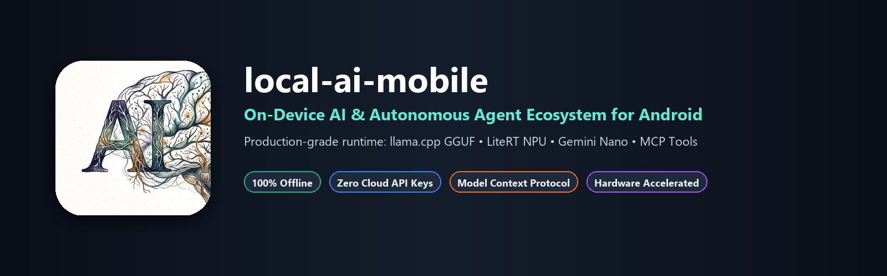

# local-ai-mobile

<p align="center">
  <a href="https://localai.shanaka.dev/">
    
  </a>
</p>

<h3 align="center">
  Production-Grade, 100% Offline, On-Device AI Ecosystem for Android Developers
</h3>

<p align="center">
  Empowering Android applications to run large language models, expose Model Context Protocol (MCP) system tools, and orchestrate autonomous multi-step agentic reasoning completely on-device — zero cloud API keys, zero subscription costs, and 100% data privacy.
</p>

<p align="center">
  <a href="https://localai.shanaka.dev/"></a>
  <a href="https://play.google.com/store/apps/details?id=dev.shanaka.localai"></a>
  <a href="https://opensource.org/licenses/Apache-2.0"></a>
  <a href="https://developer.android.com"></a>
  <a href="https://kotlinlang.org"></a>
  <a href="#ecosystem-architecture"></a>
  <a href="https://modelcontextprotocol.io"></a>
  <a href="#repository-matrix"></a>
</p>

---

## 🌟 Executive Overview

**local-ai-mobile** is an open-source engineering initiative providing Android developers with modular, enterprise-ready building blocks for **on-device AI** and **mobile LLM inference**. Instead of sending private user conversations, device sensors, and system files over cellular networks to costly third-party cloud servers, our ecosystem enables physical hardware silicon — including Qualcomm Hexagon NPUs, MediaTek APUs, Vulkan GPUs, and ARM NEON SIMD engines — to process inferences and coordinate autonomous actions with sub-millisecond latencies and zero data leakage.

The ecosystem is architected into three specialized, decoupled, and independently deployable libraries under the **Apache 2.0** license:

1. **`android-inference-engine`**: Universal on-device inference runtime powering **offline llama.cpp Android** (GGUF universal quantization), Google **LiteRT NPU acceleration** (formerly TensorFlow Lite), and **Gemini Nano Android** via Android 14+ AICore.
2. **`android-mcp-tools`**: The standard **Android Model Context Protocol** (MCP) implementation providing 9 on-device system tools, robust multi-IPC transports (AIDL, ContentProvider, Messenger, HTTP/SSE), and strict 4-mode user authorization gates.
3. **`android-agent-workflow`**: Production-ready **autonomous mobile agent** framework featuring an iterative **Plan-Execute-Observe-Verify** reasoning loop, mobile **context distillation** (~300 char compaction), 3-tier request routing, and battery-guarded background execution.

---

<a id="flagship-app"></a>
## 📱 Experience the Flagship App on Android

The libraries across the **local-ai-mobile** ecosystem serve as the high-performance core engine powering **Local AI**, the flagship consumer Android application for private on-device intelligence:

- 🌐 **Official Website**: [https://localai.shanaka.dev/](https://localai.shanaka.dev/)
- 📲 **Google Play Store**: [Get Local AI on Google Play](https://play.google.com/store/apps/details?id=dev.shanaka.localai)
- 🔒 **100% Offline & Private**: Experience ultra-low latency token generation, system tool discovery, and autonomous agent loops directly on your Android smartphone — zero cloud subscriptions, zero data tracking.

---

<a id="architecture"></a>
<a id="ecosystem-architecture"></a>
## 🏗️ Ecosystem Architecture

The diagram below illustrates the end-to-end architecture of the **local-ai-mobile** stack, from top-level Android UI applications down to specialized device silicon:

```
+=============================================================================+
|                          Android Application Layer                          |
|             (Jetpack Compose UI, Foreground Services, WorkManager)          |
+=============================================================================+
                                       │
                                       ▼
+=============================================================================+
|                         android-agent-workflow                              |
|  • Autonomous Plan-Execute-Observe-Verify Reasoning Loop                    |
|  • 3-Tier Intelligent Coordinator:                                          |
|      - Tier 1: Instant Chit-Chat (0 tool calls, 0 overhead)                 |
|      - Tier 2: Single Tool Fast Path (Deterministic & Scoped Generative)    |
|      - Tier 3: Multi-Step Agentic Pipelines & Slash Commands (/plan,/boost) |
|  • Context Distillation (~300 char compaction) & Rolling Window (4 turns)   |
|  • Isolated Context Scratchpad (0 token pollution in conversation history)   |
|  • SQLite Checkpoint State Machine & Battery-Safe WorkManager Scheduling    |
+======================================+======================================+
                                       │
                ┌──────────────────────┴──────────────────────┐
                ▼                                             ▼
+==============================+             +================================+
|      android-mcp-tools       |             |    android-inference-engine    |
| • Model Context Protocol     |             | • Dual-Engine Architecture:    |
|   (2024-11-05 Specification) |             |     - llama.cpp GGUF Universal |
| • 9 Sandboxed System Tools:  |             |     - LiteRT NPU / GPU / CPU   |
|   - device_telemetry         |             |     - Gemini Nano AICore System|
|   - clipboard_copilot        |             | • Hardware Profiler & KleidiAI |
|   - math_evaluator           |             | • Real-Time TPS & Context Cfg  |
|   - device_clock_timer       |             | • Thermal Throttling Guards    |
|   - file_inspector (sandbox) |             | • Power & Battery Checkpoints  |
|   - notes & calendar store   |             | • Dynamic Tokenizer Templates  |
| • Multi-IPC Transports:      |             |   (ChatML, Llama3, Gemma, Phi) |
|   - ContentProvider & AIDL   |             +================================+
|   - Loopback HTTP/SSE (8765) |                              │
| • 4 Security Approval Modes  |                              │
|   (ALWAYS_ASK, SENSITIVE,    |                              │
|    AUTO_DECIDE, NEVER_ASK)   |                              │
+==============================+                              │
                │                                             │
                └──────────────────────┬──────────────────────┘
                                       │
                                       ▼
+=============================================================================+
|                        Android Device Hardware Layer                        |
|                                                                             |
|  [Qualcomm Snapdragon]      [MediaTek Dimensity]         [Google Tensor]    |
|   Hexagon HTP / NPU          NeuroPilot APU               EdgeTPU           |
|   Adreno GPU (Vulkan)        Mali / Immortalis GPU        Mali GPU          |
|                                                                             |
|  [Generic 64-bit ARMv8 / ARMv9 CPU Silicon]                                 |
|   ARM NEON SIMD Vectorization • DotProd / I8MM • KleidiAI Micro-Kernels     |
+=============================================================================+
```

---

<a id="build-status"></a>
<a id="repository-matrix"></a>
## 📦 Repository Matrix

Every repository in the `local-ai-mobile` ecosystem is built as an independent, fully tested, and self-contained open-source project.

| Repository | Description | Key Capabilities | Maven Coordinates |
| :--- | :--- | :--- | :--- |
| [**`android-inference-engine`**](https://github.com/local-ai-mobile/android-inference-engine) | Universal on-device LLM inference runtime with zero cloud dependencies. | • llama.cpp GGUF universal quantization<br>• LiteRT NPU & GPU delegate acceleration<br>• Gemini Nano Android 14+ AICore integration<br>• Thermal throttling & battery guards | `dev.localai.inference:inference-engine:1.0.0` |
| [**`android-mcp-tools`**](https://github.com/local-ai-mobile/android-mcp-tools) | Standard on-device Model Context Protocol server and system tool suite. | • Full MCP 2024-11-05 JSON-RPC 2.0 support<br>• 9 sandboxed on-device system tools<br>• Multi-IPC: ContentProvider, AIDL, HTTP (8765)<br>• 4 user approval security modes | `dev.localai.mcp:mcp-tools:1.0.0` |
| [**`android-agent-workflow`**](https://github.com/local-ai-mobile/android-agent-workflow) | Autonomous on-device agent framework with multi-step reasoning loops. | • Plan-Execute-Observe-Verify autonomous loop<br>• Context distillation (~300 char compaction)<br>• 3-tier coordinator & slash commands<br>• WorkManager background scheduling | `dev.localai.agent:agent-workflow:1.0.0` |

---

## ⚡ 10-Line Developer Quickstart

Integrating on-device AI, system tools, and autonomous agent loops requires only a few lines of clean, idiomatic Kotlin code:

```kotlin
// 1. Initialize on-device inference engine with NPU acceleration
val inference = InferenceEngine.create(context).apply {
    loadModel("models/qwen2.5-3b-instruct-q4_k_m.gguf", EngineOptions(useNpu = true, threadCount = 4))
}
// 2. Initialize MCP system tool registry with 4-mode security gating
val tools = McpToolRegistry.createDefault(context, approvalMode = AgentApprovalMode.SENSITIVE_ONLY)

// 3. Build the autonomous workflow engine connecting inference and tools
val agent = AgentWorkflowEngine.Builder(context)
    .withInferenceEngine(inference)
    .withToolRegistry(tools)
    .build()

// 4. Execute an autonomous multi-step objective 100% offline
val session = agent.executeObjective("/plan Check battery drain, inspect logcat errors, and summarize notes")

// 5. Inspect the verified resolution (zero cloud API keys, zero data leaves the device)
println("Final Resolution: ${session.resolution?.finalResponse}")
```

---

## 🚀 Hardware Acceleration & Silicon Support Matrix

Our runtimes leverage physical silicon acceleration across major mobile chipsets:

| Manufacturer / Platform | Silicon Family | Acceleration Engine | Precision / Formats | Supported Backends |
| :--- | :--- | :--- | :--- | :--- |
| **Qualcomm Snapdragon** | Snapdragon 8 Gen 1 / 2 / 3 / 4, 7+ Gen 2 | Hexagon NPU (HTP) & Adreno GPU | INT4, INT8, FP16 | Qualcomm QNN, LiteRT HTP Delegate, Vulkan Compute |
| **MediaTek Dimensity** | Dimensity 9000 / 9200 / 9300 / 9400 | NeuroPilot APU & Mali/Immortalis GPU | INT8, FP16 | MediaTek NeuroPilot, LiteRT APU Delegate, Vulkan |
| **Google Tensor** | Tensor G1 / G2 / G3 / G4 | Google EdgeTPU | INT8, FP16 | LiteRT EdgeTPU Delegate, Android AICore Gemini Nano |
| **Samsung Exynos** | Exynos 2200 / 2400 | Xclipse GPU (AMD RDNA) & NPU | FP16, INT8 | Vulkan Compute, LiteRT NPU Delegate |
| **Generic ARMv8 / ARMv9** | Cortex-A55 / A78 / X1 / X2 / X3 / X4 / X925 | CPU SIMD & Vector extensions | Q4_K_M, Q8_0, FP16 | ARM NEON, DotProd, I8MM, KleidiAI Optimized Kernels |

---

## 🔍 Developer SEO & Keyword Discovery

Engineered for mobile AI practitioners, systems engineers, and Android architects searching for:
- **on-device AI**: Run state-of-the-art transformer models directly in client apps without recurring cloud inference costs.
- **mobile LLM inference**: Ultra-low-latency text generation, token streaming, and speculative decoding on Android.
- **Android Model Context Protocol**: Standardized client-server protocol enabling LLMs to safely query local databases, inspect files, and execute system commands.
- **MCP server Android**: Native Kotlin implementation of Anthropic's Model Context Protocol over AIDL, ContentProvider, and loopback HTTP/SSE.
- **autonomous mobile agent**: ReAct planning loops, step-by-step tool execution, and verification gates designed for edge resource budgets.
- **offline llama.cpp Android**: High-performance C++ GGUF inference compiled for Android ABI targets (`arm64-v8a`, `armeabi-v7a`, `x86_64`).
- **LiteRT NPU acceleration**: Leverage Google's official on-device machine learning runtime with hardware-accelerated delegates.
- **Gemini Nano Android**: Integrate zero-byte APK system models on Android 14+ via official AICore services.
- **privacy-first mobile AI**: Guarantee HIPAA, GDPR, and enterprise compliance by ensuring zero bytes of user data ever transit the network.

---

## 🛡️ Security & Privacy Architecture

Security in **local-ai-mobile** is designed from the silicon layer up:
- **Sandboxed File Operations**: All file inspector operations strictly validate paths against canonical storage directories, preventing path traversal attacks (`../`).
- **Caller Identity Verification**: IPC endpoints verify the package signature and UID of calling applications.
- **Context Distillation & Prompt Defense**: Tool outputs are distilled (~300 characters) and kept in isolated scratchpads, mitigating adversarial prompt injections.
- **Thermal & Memory Throttling**: Real-time hardware listeners throttle generation or suspend background tasks when thermal thresholds (`THERMAL_STATUS_SEVERE`) or memory limits are approached.

For full disclosure policies and vulnerability reporting procedures, refer to [**SECURITY.md**](../SECURITY.md).

---

## 🤝 Community Gateway & Contributing

We actively welcome contributions, issue reports, tool integrations, and hardware optimizations!

- **Contributing Guide**: Please review our [Contribution Guidelines](../CONTRIBUTING.md) before submitting pull requests.
- **Issue Tracker**: Submit bug reports and feature requests via our structured [Issue Templates](https://github.com/local-ai-mobile/.github/issues/new/choose).
- **Discussions**: Join architectural debates, share benchmarks, and showcase community apps on [GitHub Discussions](https://github.com/orgs/local-ai-mobile/discussions).
- **Security Inquiries**: Report security vulnerabilities responsibly to `security@local-ai-mobile.dev` or via [Security Advisories](https://github.com/local-ai-mobile/.github/security/advisories).
- **License**: All projects are proudly distributed under the [Apache License, Version 2.0](../LICENSE).

---

<p align="center">
  <b>Built with ❤️ by the local-ai-mobile community</b><br>
  <i>Empowering developers to build the next generation of private, on-device intelligence.</i>
</p>
